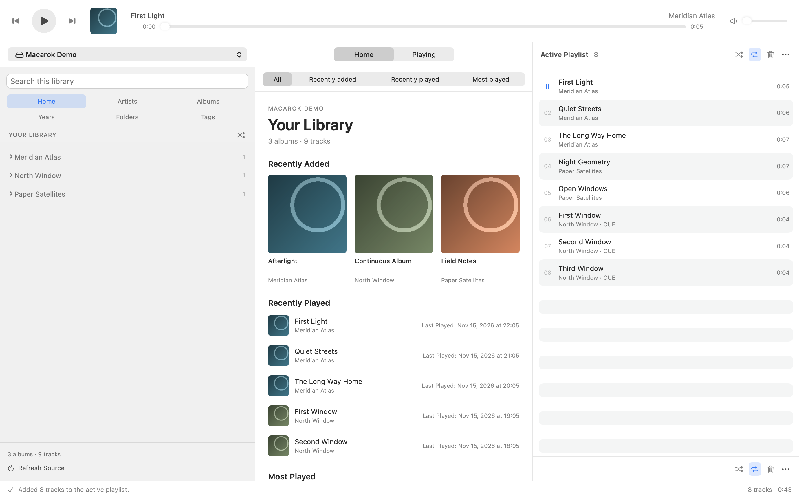
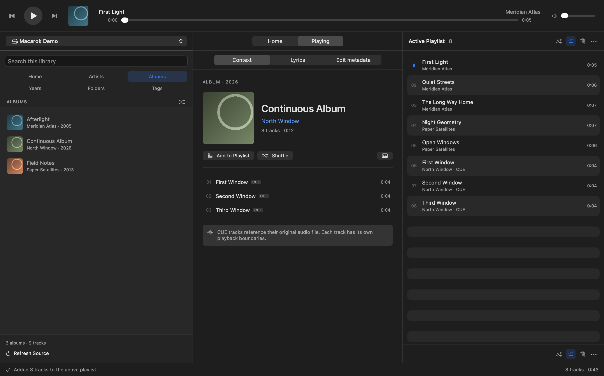
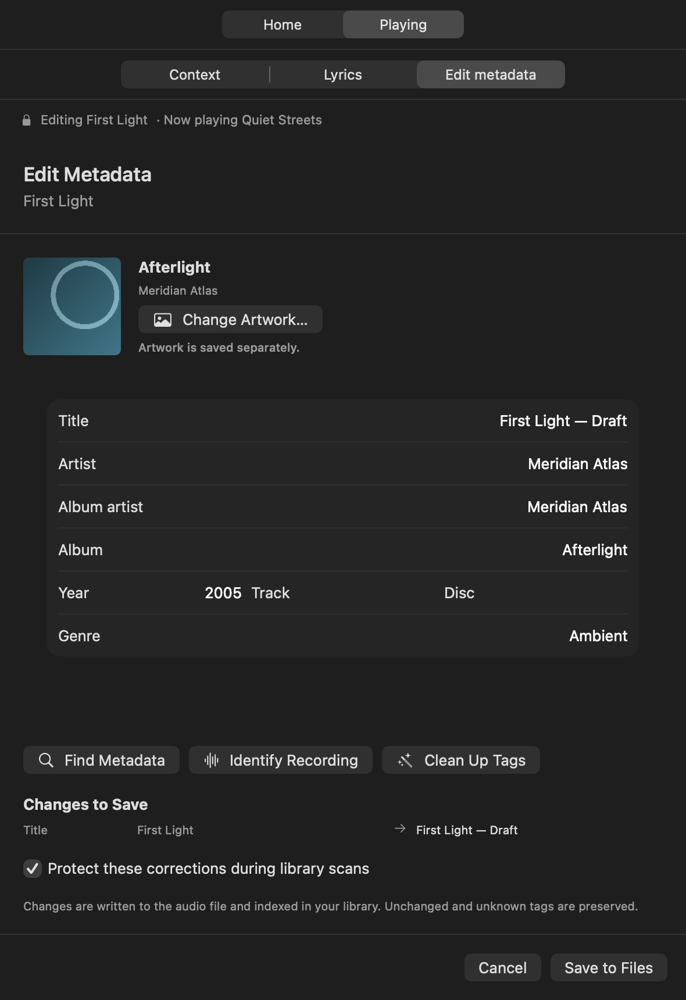
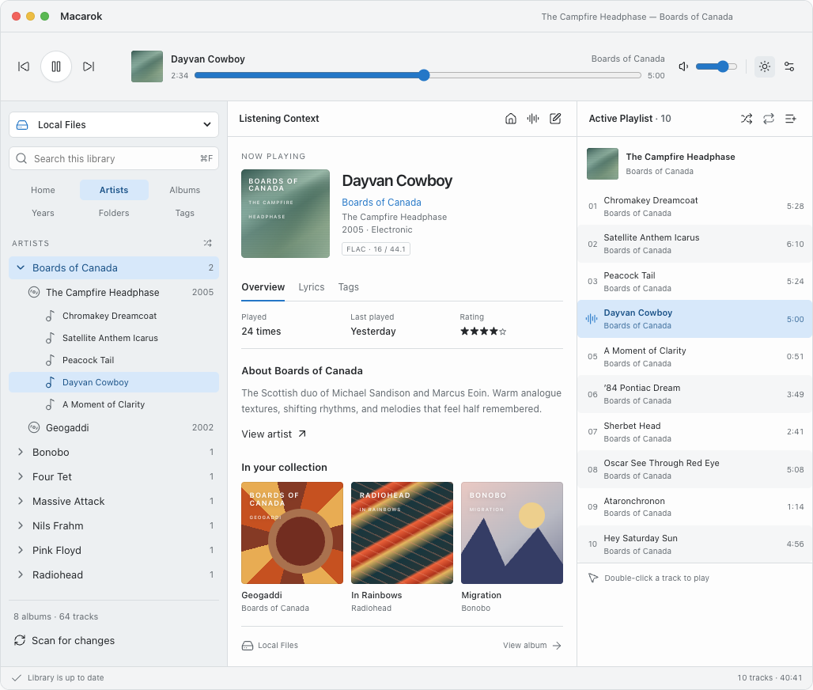
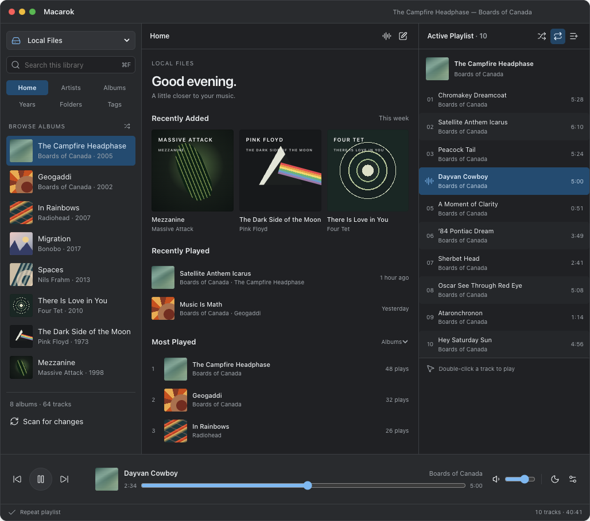

# Macarok

A native macOS music player inspired by Amarok 1.4: a searchable library, rich listening context, and an active playlist in three persistent panels.

**Status:** native macOS application in development. The SwiftUI app includes libVLC 4 playback, a SQLite library, local/OpenSubsonic/Bandcamp/podcast sources, Internet radio, optional Last.fm scrobbling, CUE tracks, and metadata/artwork editors.

## Download

Get the DMG from [GitHub Releases](https://github.com/armateurlabs/macarok/releases), open it, and drag Macarok to Applications. Release builds currently support Apple Silicon Macs with macOS 14 or later. They are ad-hoc signed and not notarized by Apple; macOS may block the first launch.

## Build and run

Requires macOS 14 or later and Xcode 26 / Swift 6.2 or later. Development is currently verified with Xcode 27.1 on Apple Silicon.

```sh
./scripts/build-app.sh release
open dist/Macarok.app
```

The build script embeds VLCKit, resource bundles, the app icon, notices, and the optional Chromaprint helper, then signs and verifies the application locally. The pinned VLC 4 development archive includes all Apple platforms, so its first download is approximately 910 MB. Subsequent builds use SwiftPM's cache. Set `MACAROK_INCLUDE_FPCALC=0` to omit audio fingerprinting.

Open `Package.swift` in Xcode for development, or use `swift build` and `swift test` from the command line. The app bundle is the recommended way to run the application with its resources and macOS integration.

To build a versioned disk image locally, run `./scripts/package-dmg.sh 0.1.0 1`. Tags such as `v0.1.0` trigger the GitHub Actions release workflow. See [release procedures](docs/RELEASING.md).

## Native application

- Three resizable panels: library, listening context/lyrics, and active playlist, with matching panel headers.
- Browse one source or opt into All Sources; artist names group together while albums, tracks, folders, and credentials retain their origins.
- System, Light, and Dark appearances; artist, album, year, folder, and tag browsing.
- Local MP3, FLAC, Ogg Vorbis, Opus, and other TagLib/VLC formats; OpenSubsonic original streams; RSS/Atom podcasts.
- Source catalog with Bandcamp setup, Podcast Index / Apple Podcasts discovery, and Radio Browser search or direct station URLs.
- CUE sheets expose individual tracks without splitting the original audio.
- Persistent playlists, queue, listening history, ratings, and scope-aware search through SQLite/FTS5.
- Home includes Recently Added, Recently Played with fixed local dates, separate Tracks, Artists, and Albums rankings, and Radio Favorites in All Sources.
- Centered Home / Playing navigation has a fixed second menu row: Home filters or Context / Lyrics / Edit metadata. Track changes retain the selected mode and detail tab; active metadata and artwork editors keep their original target.
- Synchronized lyrics from local files, OpenSubsonic, and LRCLIB, with manual search/corrections, caching, highlighting, and optional file export.
- Double-click a track, album, or artist to start an empty playlist; track double-click choices include Add to Playlist, Add After Current Track, and Play Now. Album and artist actions always use their complete track lists.
- Playlist controls at the top and bottom, contextual shuffle that appends to an existing queue, None / Playlist / Track repeat, and native Undo / Redo for playlist edits.
- Mac media keys, configurable local and global shortcuts, held Left / Right keys for seeking, and adjustable streaming buffering.
- Optional Last.fm scrobbling with personal API credentials, browser authorization, source exclusions, and a persistent submission queue.
- Metadata cleanup, MusicBrainz release matching with change previews, TagLib file writes, and embedded/local/web artwork.
- Optional recording identification through Chromaprint and AcoustID, using your own application client key stored in Keychain.
- HTTP and HTTPS, with explicit server-specific trust for self-signed certificates shared by library, artwork, and audio requests.

Single-source browsing remains the default. All Sources combines cached indexes and refreshes each source serially when requested; it does not merge stored copies. The library footer starts or stops refresh and shows progress. Crossfade and quality-tuning controls are outside the current scope. Gapless playback is optional. Bandcamp uses its OpenSubsonic endpoint and generated credentials. Qobuz, Deezer, and Spotify do not have playback connectors. See [source setup and availability](docs/SOURCES.md).

Clear Playlist keeps the current entry while it is playing or opening. When paused or stopped, it empties the playlist. Command-Z and Shift-Command-Z undo and redo playlist content edits; text fields keep their own undo history. Bare Left / Right seek by five seconds per key press and continue while held; Command-Left / Command-Right remain Previous / Next by default.

Radio stations have their own Stations / Favorites views and remain outside music albums and listening rankings. Direct HTTP/HTTPS streams, M3U, and PLS wrappers are supported. The player shows live metadata when provided, with explicit reconnect after disconnection; HLS is currently unsupported. Podcast search selects a publisher feed before subscribing. Last.fm is disabled until you configure your own API key and shared secret and authorize your account. See [Last.fm setup and privacy](docs/SCROBBLING.md).

AcoustID lookup sends a fingerprint and duration after an explicit Identify action. It supports whole local files; individual CUE tracks use artist/album metadata search. Remote edits are local library overlays. Each local file replacement is atomic; an album spanning several files can be partially saved if a later file fails.

Lyrics are retrieved only while the Lyrics panel is open, following the current queue track or the inspected track when no current entry exists. Automatic LRCLIB lookup sends the title, artist, album, and duration to that public service after local/server fallbacks. Edit / Paste saves a private library correction. Save to Files is explicit: local audio receives lyrics tags and synchronized sidecars; CUE segments receive separate track sidecars. Remote originals are never written and lyrics are never submitted publicly. See [lyrics behavior and storage](docs/LYRICS.md).

See [verification and remaining manual checks](docs/VERIFICATION.md), [testing and synthetic demo data](docs/TESTING.md), [product decisions](docs/PRODUCT.md), and the [direct cloud-storage feasibility study](docs/CLOUD-STORAGE.md).

## Native interface previews

Offscreen renders of the implemented SwiftUI views, using the synthetic demo collection:






The metadata editor keeps its target and draft while the next track plays:



## Explore the mockups

Open the standalone preview on macOS:

```sh
open design/mockups/index.html
```

Use the switcher below the window to compare **Collection** and **Albums**. Both designs support System, Light, and Dark appearances through the monitor/sun/moon button.

- Browse source-specific Home, Artists, Albums, Years, Folders, and Tags views.
- Double-click a library track to append it; double-click a playlist entry to play it.
- Cycle the repeat button through **None → Playlist → Track → None**.
- Inspect CUE tracks, metadata editing, artwork selection, and settings.

The editable source is [macarok-ui.fragment.html](design/mockups/macarok-ui.fragment.html); [index.html](design/mockups/index.html) is the standalone preview.

## Design previews

### Collection · Light



### Albums · Dark



## Architecture

`MacarokCore` owns SQLite, indexing, CUE parsing, sources, network trust, streaming buffers, playlists, and metadata lookup. `MacarokAudio` wraps VLCKit 4. `MacarokMetadata` wraps the native TagLib bridge. `MacarokApp` contains the SwiftUI interface and playback orchestration.

Dependencies and binary artifacts are pinned in `Package.swift` and `Package.resolved`. See [third-party notices](Support/ThirdPartyNotices.md).

All code, identifiers, comments, and project documentation are written in English.

## License

Macarok is licensed under the [MIT License](LICENSE). Bundled dependencies retain their own licenses; see [third-party notices](Support/ThirdPartyNotices.md).
