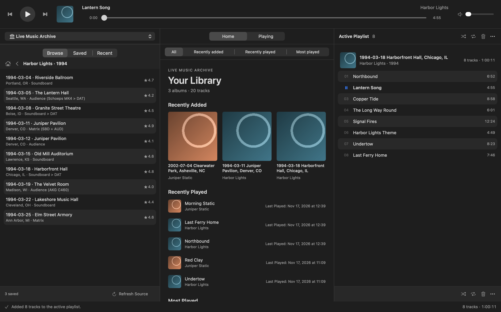
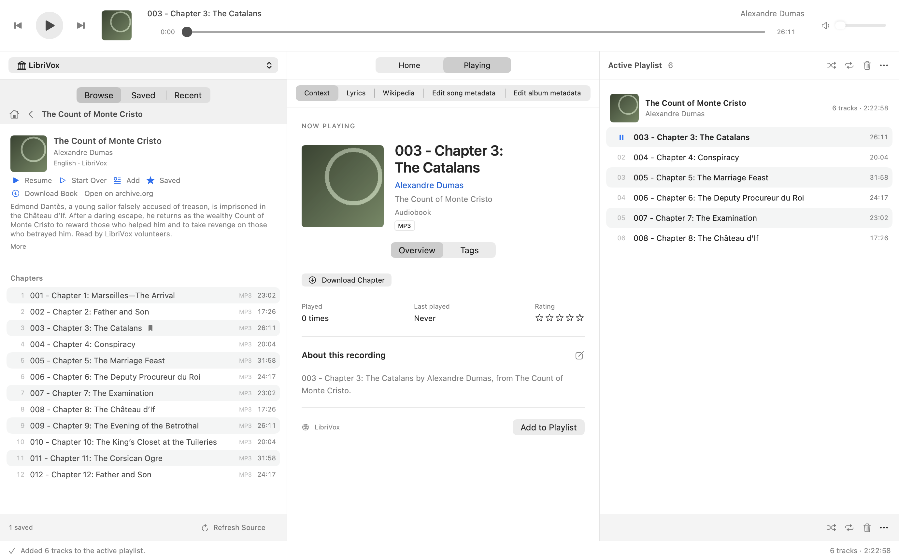
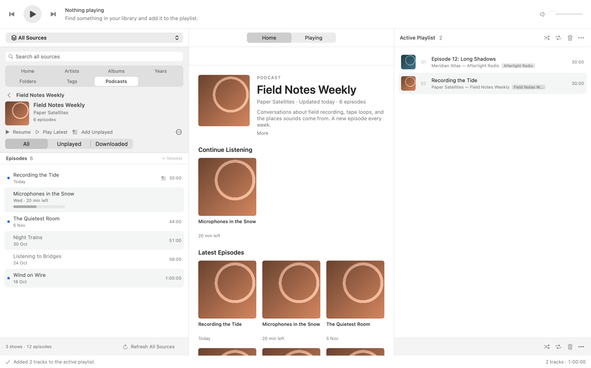
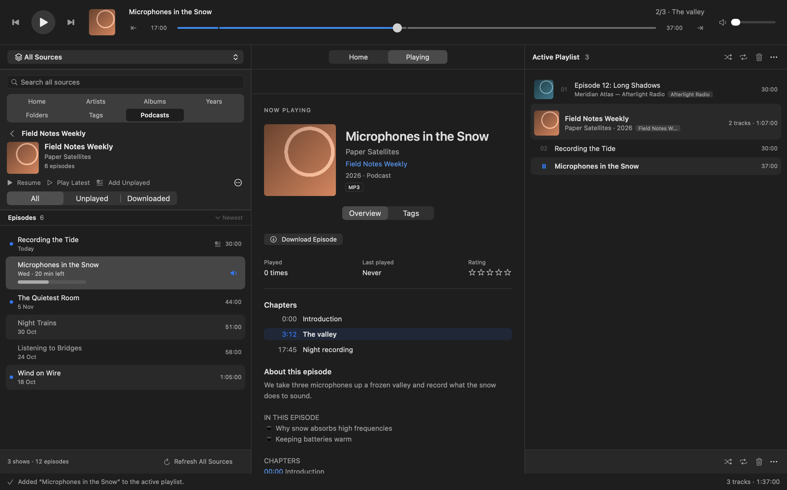
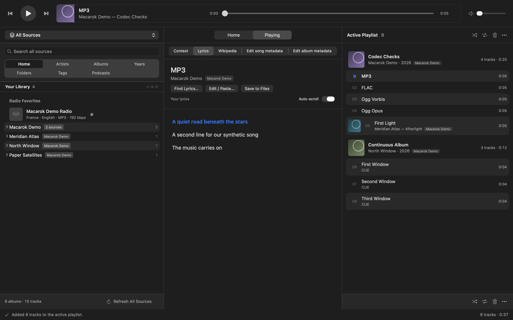
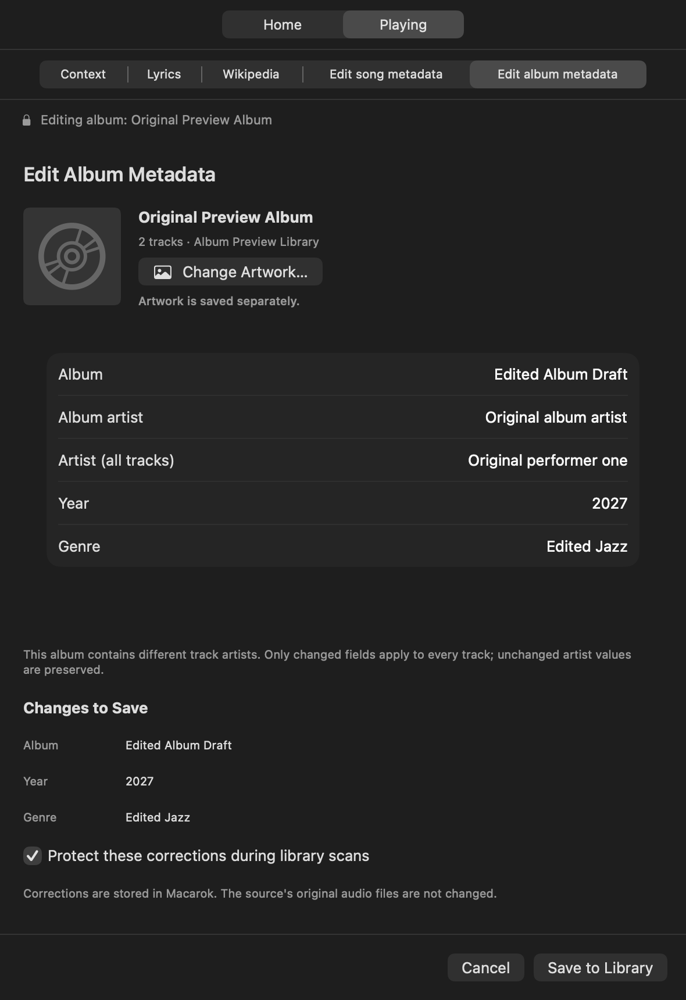
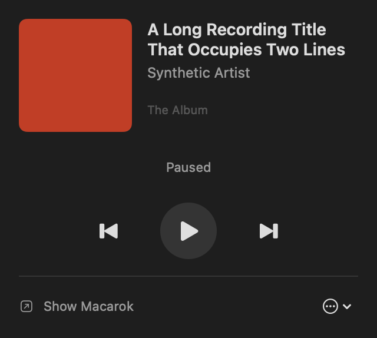

<p align="center">
  
</p>

# Macarok

A native macOS music player inspired by Amarok 1.4: a searchable library, rich listening context, and an active playlist in three persistent panels.

**Status:** native macOS application in development. The SwiftUI app includes libVLC 4 playback, a SQLite library, local/OpenSubsonic/Bandcamp/podcast sources, Internet radio, Internet Archive (Live Music Archive and LibriVox), optional Last.fm scrobbling, CUE tracks, and metadata/artwork editors.

## Download

Get the DMG from [GitHub Releases](https://github.com/armateurlabs/macarok/releases), open it, and drag Macarok to Applications. Release builds currently support Apple Silicon Macs with macOS 14 or later. They are ad-hoc signed and not notarized by Apple; macOS may block the first launch.

## Screenshots

Native SwiftUI views rendered from the current application with a synthetic music collection.

**Home · Light** — library browsing, recently added albums, listening history, and the active playlist grouped by album.


**Playing · Dark** — album context and individual CUE tracks, with the album selected in the library and the playlist grouped by album.


The same views are available in [Home · Dark](design/native/home-dark.png) and [Playing · Light](design/native/cue-album-light.png).

**Live Music Archive · Dark** — an artist's recordings for one year, with date, venue, recording source, and listener rating; saved shows appear in Home.



**LibriVox · Light** — a saved audiobook with its resume point, chapters, and the current chapter playing.



**Podcasts · Light** — shows at the first level of their own library tab, an open show with dated episodes, listening progress, and the show's Home.



**Podcast chapters · Dark** — chapter gaps on the timeline, the current chapter beside the title, chapter buttons, and the episode's chapter list.



Podcast views are also available as [Shows · Light](design/native/podcasts-shows-light.png), [New episodes · Dark](design/native/podcasts-new-dark.png), and [Show · Dark](design/native/podcasts-show-dark.png).

Internet Archive views are also available in [Live Music Archive · Light](design/native/archive-live-light.png) and [LibriVox · Dark](design/native/archive-librivox-dark.png). They are rendered from synthetic recordings and cached responses, without contacting archive.org.

<details>
<summary>Lyrics, metadata editors, and more native views</summary>

**Synchronized lyrics and All Sources**



**Pinned song metadata editor** — the target and draft stay in place when the queue advances.


**Album metadata editor** — shared album fields without individual song titles or numbering.



The album editor is also available in [Light](design/native/album-metadata-light.png), with compact [Light](design/native/album-metadata-narrow-light.png) and [Dark](design/native/album-metadata-narrow-dark.png) layouts.

**Menu bar mini player** — also with [podcast chapters](design/native/menu-bar-mini-player-chapters-dark.png).



Additional views show the [panel footers](design/native/panel-footers-dark.png), [alternating library and playlist rows](design/native/list-rows-dark.png), [buffered podcast coverage](design/native/podcast-timeline-dark.png), [completed episode downloads](design/native/podcast-timeline-downloaded-dark.png), and playback diagnostics in [Light](design/native/playback-diagnostics-light.png) and [Dark](design/native/playback-diagnostics-dark.png).

</details>

The original design explorations remain in [the mockup gallery](design/mockups/index.html). See [playback performance](docs/PLAYBACK-PERFORMANCE.md) for the background work and streaming architecture.

## Build and run

Requires macOS 14 or later and Xcode 26 / Swift 6.2 or later. Development is currently verified with Xcode 27.1 on Apple Silicon.

```sh
./scripts/build-app.sh release
open dist/Macarok.app
```

The build script embeds VLCKit, resource bundles, the app icon, notices, and the optional Chromaprint helper, then signs and verifies the application locally. The pinned VLC 4 development archive includes all Apple platforms, so its first download is approximately 910 MB. Subsequent builds use SwiftPM's cache. Set `MACAROK_INCLUDE_FPCALC=0` to omit audio fingerprinting.

The wolf-and-apple icon is generated from the checked-in artwork at every build. See [icon sources and regeneration](Support/ICON.md).

Open `Package.swift` in Xcode for development, or use `swift build` and `swift test` from the command line. The app bundle is the recommended way to run the application with its resources and macOS integration.

To build a versioned disk image locally, run `./scripts/package-dmg.sh 0.7.0 3`. Tags such as `v0.7.0` trigger the GitHub Actions release workflow. See [release procedures](docs/RELEASING.md).

## Native application

- Three resizable panels: library, listening context/lyrics, and active playlist, with matching panel headers.
- Browse one source or opt into All Sources; artist names group together while albums, tracks, folders, and credentials retain their origins.
- System, Light, and Dark appearances; artist, album, year, folder, and tag browsing.
- Local MP3, FLAC, Ogg Vorbis, Opus, and other TagLib/VLC formats; OpenSubsonic original streams; RSS/Atom podcasts.
- Source catalog with Bandcamp setup, Podcast Index / Apple Podcasts discovery, Radio Browser search or direct station URLs, and on-demand browsing of the Live Music Archive and LibriVox audiobooks.
- CUE sheets expose individual tracks without splitting the original audio.
- Persistent playlists, queue, listening history, ratings, and scope-aware search through SQLite/FTS5.
- Home includes Recently Added, Recently Played with fixed local dates, separate Tracks, Artists, and Albums rankings, and Radio Favorites in All Sources.
- Centered Home / Playing navigation has a fixed second menu row: Home filters or Context / Lyrics / Wikipedia / Edit song metadata / Edit album metadata. Track changes retain the selected mode and detail tab; active metadata and artwork editors keep their original target.
- Podcast timelines show gray unavailable data, white buffered/downloaded coverage, and blue playback progress. Explicit episode downloads support offline playback, Reveal in Finder, and manual removal; see [podcast storage and cleanup](docs/PODCASTS.md).
- Artist/album Wikipedia context with editable search, loading cancellation, and Open in Browser; see [Wikipedia behavior and content licenses](docs/WIKIPEDIA.md).
- Synchronized lyrics from local files, OpenSubsonic, and LRCLIB, with manual search/corrections, caching, highlighting, and optional file export.
- Double-click a track, album, or artist to start an empty playlist; track double-click choices include Add to Playlist, Add After Current Track, and Play Now. Album and artist actions always use their complete track lists.
- Playlist controls at the top and bottom, contextual shuffle that appends to an existing queue, None / Playlist / Track repeat, and native Undo / Redo for playlist edits.
- Matching native alternating rows in the library and playlist; unused space below the last entry stays plain.
- Mac media keys, configurable local and global shortcuts, held Left / Right keys for seeking, and adjustable streaming buffering.
- Prepared next-track handoffs, targeted local rescans, playback stall detection, and a session-only **Help → Playback Diagnostics…** panel with explicit export.
- Optional menu bar mini player with album artwork, playback controls, and main-window access, disabled by default.
- Optional Last.fm scrobbling with personal API credentials, browser authorization, source exclusions, and a persistent submission queue.
- Metadata cleanup, MusicBrainz release matching with change previews, TagLib file writes, and embedded/local/web artwork.
- Separate song and album editors. Album edits apply changed shared fields to the complete album in its actual source while preserving individual titles, numbering, CUE boundaries, and listening history.
- Optional recording identification through Chromaprint and AcoustID, using your own application client key with optional Keychain storage.
- HTTP and HTTPS, with explicit server-specific trust for self-signed certificates shared by library, artwork, and audio requests.

Single-source browsing remains the default. All Sources combines cached indexes and refreshes each source serially when requested; it does not merge stored copies. The library footer starts or stops refresh and shows progress. Crossfade and quality-tuning controls are outside the current scope. Gapless playback is optional. Bandcamp uses its OpenSubsonic endpoint and generated credentials. Qobuz, Deezer, and Spotify do not have playback connectors. See [source setup and availability](docs/SOURCES.md).

Clear Playlist keeps the current entry while it is playing or opening. When paused or stopped, it empties the playlist. Command-Z and Shift-Command-Z undo and redo playlist content edits; text fields keep their own undo history. Bare Left / Right seek by five seconds per key press and continue while held; Command-Left / Command-Right remain Previous / Next by default.

Radio stations have their own Stations / Favorites views and remain outside music albums and listening rankings. Direct HTTP/HTTPS streams, M3U, and PLS wrappers are supported. The player shows live metadata when provided, with explicit reconnect after disconnection; HLS is currently unsupported. Podcast search selects a publisher feed before subscribing. Last.fm is disabled until you configure your own API key and shared secret and authorize your account. See [Last.fm setup and privacy](docs/SCROBBLING.md).

AcoustID lookup sends a fingerprint and duration after an explicit Identify action. Whole local files are resolved through the current source bookmark, including a moved source directory or renamed explicitly opened file; individual CUE tracks use artist/album metadata search. A usable partial fingerprint can still be looked up with a separate decoding warning. The sheet reports completed lookups with matches or no recording metadata, separately from helper or service errors. Remote edits are local library overlays. Each local file replacement is atomic; an album spanning several files can be partially saved if a later file fails.

Lyrics are retrieved only while the Lyrics panel is open, following the current queue track or the inspected track when no current entry exists. Automatic LRCLIB lookup sends the title, artist, album, and duration to that public service after local/server fallbacks. Edit / Paste saves a private library correction. Save to Files is explicit: local audio receives lyrics tags and synchronized sidecars; CUE segments receive separate track sidecars. Remote originals are never written and lyrics are never submitted publicly. See [lyrics behavior and storage](docs/LYRICS.md).

Similar playlists and mixes send only seed artist names and titles to Last.fm (when configured), ListenBrainz, and MusicBrainz, and suggest only tracks from your library. See [similar playlists and mixes](docs/RECOMMENDATIONS.md).

See [verification and remaining manual checks](docs/VERIFICATION.md), [testing and synthetic demo data](docs/TESTING.md), [product decisions](docs/PRODUCT.md), and the [direct cloud-storage feasibility study](docs/CLOUD-STORAGE.md).

## Architecture

`MacarokCore` owns SQLite, indexing, CUE parsing, sources, network trust, streaming buffers, playlists, and metadata lookup. `MacarokAudio` wraps VLCKit 4. `MacarokMetadata` wraps the native TagLib bridge. `MacarokApp` contains the SwiftUI interface and playback orchestration.

Dependencies and binary artifacts are pinned in `Package.swift` and `Package.resolved`. See [third-party notices](Support/ThirdPartyNotices.md).

All code, identifiers, comments, and project documentation are written in English.

## License

Macarok is licensed under the [MIT License](LICENSE). Bundled dependencies retain their own licenses; see [third-party notices](Support/ThirdPartyNotices.md).
